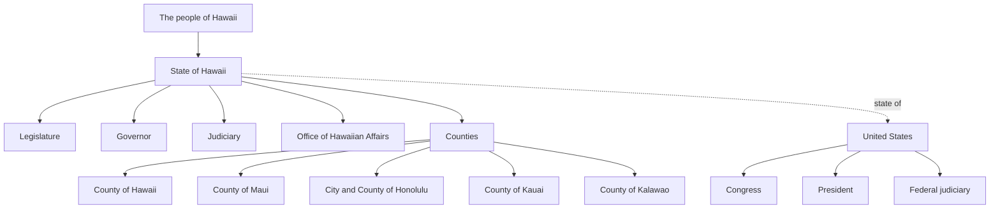
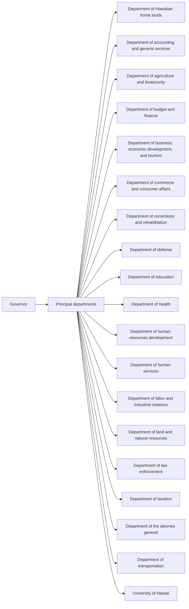
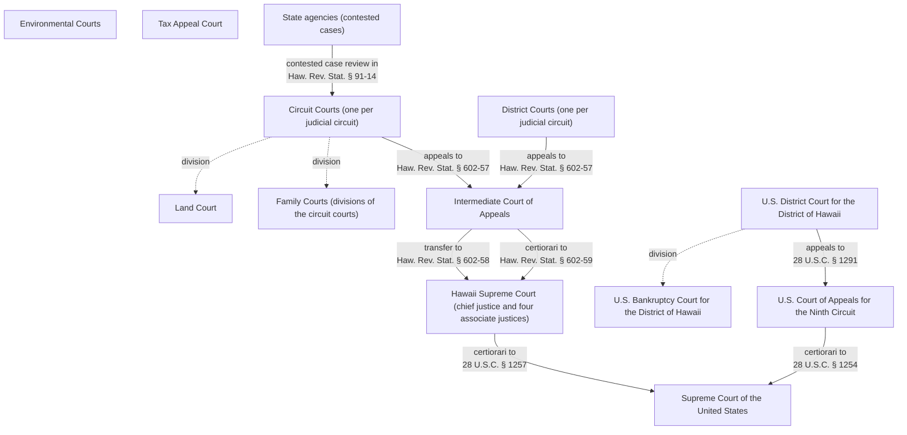

# Government of Hawaii: the map

Generated from the law itself by `map/render.py`. Every box below is created by a specific provision of the Hawaii Constitution, the Hawaii Revised Statutes, the U.S. Constitution, or the U.S. Code. The build checks that the quoted words appear in that provision's text. A ✗ means they did not.

- 95 structural parts, 95 verified against the text
- 295 boards, commissions, offices, programs and funds found by reading the HRS for the words that create them ([bodies_mined.csv](bodies_mined.csv)); each keeps the sentence it came from
- 32 connections (supervision, appointment, appeals), each with its citation

## 1. From the people outward

| Part | Created by | The law's words |
|---|---|---|
| The people of Hawaii | [Haw. Const. art. I, § 1](https://capitol.hawaii.gov/hrscurrent/Vol01_Ch0001-0042F/05-CONST/CONST_0001-0001.htm) | “All political power of this State is inherent in the people” |
| State of Hawaii | [Haw. Const. art. I, § 1](https://capitol.hawaii.gov/hrscurrent/Vol01_Ch0001-0042F/05-CONST/CONST_0001-0001.htm) | “All government is founded on this authority” |
| Legislature | [Haw. Const. art. III, § 1](https://capitol.hawaii.gov/hrscurrent/Vol01_Ch0001-0042F/05-CONST/CONST_0003-0001.htm) | “The legislative power of the State shall be vested in a legislature” |
| Governor | [Haw. Const. art. V, § 1](https://capitol.hawaii.gov/hrscurrent/Vol01_Ch0001-0042F/05-CONST/CONST_0005-0001.htm) | “The executive power of the State shall be vested in a governor” |
| Judiciary | [Haw. Const. art. VI, § 1](https://capitol.hawaii.gov/hrscurrent/Vol01_Ch0001-0042F/05-CONST/CONST_0006-0001.htm) | “The judicial power of the State shall be vested in one supreme court” |
| Office of Hawaiian Affairs | [Haw. Const. art. XII, § 5](https://capitol.hawaii.gov/hrscurrent/Vol01_Ch0001-0042F/05-CONST/CONST_0012-0005.htm) | “There is hereby established an Office of Hawaiian Affairs” |
| Counties | [Haw. Const. art. VIII, § 1](https://capitol.hawaii.gov/hrscurrent/Vol01_Ch0001-0042F/05-CONST/CONST_0008-0001.htm) | “The legislature shall create counties” |
| United States | [U.S. Const. art. IV, § 3](https://constitution.congress.gov/constitution/article-4/) | “New States may be admitted by the Congress into this Union” |
| Congress | [U.S. Const. art. I, § 1](https://constitution.congress.gov/constitution/article-1/) | “All legislative Powers herein granted shall be vested in a Congress of the United States” |
| President | [U.S. Const. art. II, § 1](https://constitution.congress.gov/constitution/article-2/) | “The executive Power shall be vested in a President of the United States of America” |
| Federal judiciary | [U.S. Const. art. III, § 1](https://constitution.congress.gov/constitution/article-3/) | “The judicial Power of the United States, shall be vested in one supreme Court” |
| County charters (each county frames its own) | [Haw. Const. art. VIII, § 2](https://capitol.hawaii.gov/hrscurrent/Vol01_Ch0001-0042F/05-CONST/CONST_0008-0002.htm) | “Each political subdivision shall have the power to frame and adopt a charter for its own self-government” |
| County of Hawaii | [Haw. Rev. Stat. § 4-1](http://www.capitol.hawaii.gov/hrscurrent/Vol01_Ch0001-0042F/HRS0004/HRS_0004-0001.htm) | “The island and county of Hawaii” |
| County of Maui | [Haw. Rev. Stat. § 4-1](http://www.capitol.hawaii.gov/hrscurrent/Vol01_Ch0001-0042F/HRS0004/HRS_0004-0001.htm) | “the counties of Maui and Kalawao” |
| City and County of Honolulu | [Haw. Rev. Stat. § 1-22](http://www.capitol.hawaii.gov/hrscurrent/Vol01_Ch0001-0042F/HRS0001/HRS_0001-0022.htm) | “The word "county" includes the city and county of Honolulu” |
| County of Kauai | [Haw. Rev. Stat. § 4-1](http://www.capitol.hawaii.gov/hrscurrent/Vol01_Ch0001-0042F/HRS0004/HRS_0004-0001.htm) | “county of Kauai” |
| County of Kalawao | [Haw. Rev. Stat. § 326-34](http://www.capitol.hawaii.gov/hrscurrent/Vol06_Ch0321-0344/HRS0326/HRS_0326-0034.htm) | “The county of Kalawao shall consist of that portion of the island of Molokai” |

## 2. Legislature

| Part | Created by | The law's words |
|---|---|---|
| House of Representatives (51 members) | [Haw. Const. art. III, § 3](https://capitol.hawaii.gov/hrscurrent/Vol01_Ch0001-0042F/05-CONST/CONST_0003-0003.htm) | “The house of representatives shall be composed of fifty-one members” |
| Legislative Reference Bureau | [Haw. Rev. Stat. § 23G-3](http://www.capitol.hawaii.gov/hrscurrent/Vol01_Ch0001-0042F/HRS0023G/HRS_0023G-0003.htm) | “The purpose of the office of the legislative reference bureau” |
| Office of the Auditor | [Haw. Const. art. VII, § 10](https://capitol.hawaii.gov/hrscurrent/Vol01_Ch0001-0042F/05-CONST/CONST_0007-0010.htm) | “shall appoint an auditor” |
| Office of the Ombudsman | [Haw. Rev. Stat. § 96-2](http://www.capitol.hawaii.gov/hrscurrent/Vol02_Ch0046-0115/HRS0096/HRS_0096-0002.htm) | “The office of ombudsman is established” |
| Senate (25 members) | [Haw. Const. art. III, § 2](https://capitol.hawaii.gov/hrscurrent/Vol01_Ch0001-0042F/05-CONST/CONST_0003-0002.htm) | “The senate shall be composed of twenty-five members” |

## 3. Executive: the governor and the principal departments

HRS § 26-4 lists the principal departments. Each one is created, and its head named, by its own section.

| Department | Created by | Headed by | Attached bodies found in HRS |
|---|---|---|---:|
| Department of Hawaiian home lands | [Haw. Rev. Stat. § 26-17](http://www.capitol.hawaii.gov/hrscurrent/Vol01_Ch0001-0042F/HRS0026/HRS_0026-0017.htm) | Hawaiian homes commission | 0 |
| Department of accounting and general services | [Haw. Rev. Stat. § 26-6](http://www.capitol.hawaii.gov/hrscurrent/Vol01_Ch0001-0042F/HRS0026/HRS_0026-0006.htm) | Comptroller | 5 |
| Department of agriculture and biosecurity | [Haw. Rev. Stat. § 26-16](http://www.capitol.hawaii.gov/hrscurrent/Vol01_Ch0001-0042F/HRS0026/HRS_0026-0016.htm) | Board of agriculture and biosecurity | 4 |
| Department of budget and finance | [Haw. Rev. Stat. § 26-8](http://www.capitol.hawaii.gov/hrscurrent/Vol01_Ch0001-0042F/HRS0026/HRS_0026-0008.htm) | Director of finance | 2 |
| Department of business, economic development, and tourism | [Haw. Rev. Stat. § 26-18](http://www.capitol.hawaii.gov/hrscurrent/Vol01_Ch0001-0042F/HRS0026/HRS_0026-0018.htm) | Director of business | 7 |
| Department of commerce and consumer affairs | [Haw. Rev. Stat. § 26-9](http://www.capitol.hawaii.gov/hrscurrent/Vol01_Ch0001-0042F/HRS0026/HRS_0026-0009.htm) | Director of commerce and consumer affairs | 4 |
| Department of corrections and rehabilitation | [Haw. Rev. Stat. § 26-14.6](http://www.capitol.hawaii.gov/hrscurrent/Vol01_Ch0001-0042F/HRS0026/HRS_0026-0014_0006.htm) | Director of corrections and rehabilitation | 2 |
| Department of defense | [Haw. Rev. Stat. § 26-21](http://www.capitol.hawaii.gov/hrscurrent/Vol01_Ch0001-0042F/HRS0026/HRS_0026-0021.htm) | Adjutant general | 1 |
| Department of education | [Haw. Rev. Stat. § 26-12](http://www.capitol.hawaii.gov/hrscurrent/Vol01_Ch0001-0042F/HRS0026/HRS_0026-0012.htm) | Board of education | 2 |
| Department of health | [Haw. Rev. Stat. § 26-13](http://www.capitol.hawaii.gov/hrscurrent/Vol01_Ch0001-0042F/HRS0026/HRS_0026-0013.htm) | Director of health | 12 |
| Department of human resources development | [Haw. Rev. Stat. § 26-5](http://www.capitol.hawaii.gov/hrscurrent/Vol01_Ch0001-0042F/HRS0026/HRS_0026-0005.htm) | Director of human resources development | 1 |
| Department of human services | [Haw. Rev. Stat. § 26-14](http://www.capitol.hawaii.gov/hrscurrent/Vol01_Ch0001-0042F/HRS0026/HRS_0026-0014.htm) | Director of human services | 3 |
| Department of labor and industrial relations | [Haw. Rev. Stat. § 26-20](http://www.capitol.hawaii.gov/hrscurrent/Vol01_Ch0001-0042F/HRS0026/HRS_0026-0020.htm) | Director of labor and industrial relations | 3 |
| Department of land and natural resources | [Haw. Rev. Stat. § 26-15](http://www.capitol.hawaii.gov/hrscurrent/Vol01_Ch0001-0042F/HRS0026/HRS_0026-0015.htm) | Board of land and natural resources | 5 |
| Department of law enforcement | [Haw. Rev. Stat. § 26-14.8](http://www.capitol.hawaii.gov/hrscurrent/Vol01_Ch0001-0042F/HRS0026/HRS_0026-0014_0008.htm) | Director of law enforcement | 2 |
| Department of taxation | [Haw. Rev. Stat. § 26-10](http://www.capitol.hawaii.gov/hrscurrent/Vol01_Ch0001-0042F/HRS0026/HRS_0026-0010.htm) | Director of taxation | 0 |
| Department of the attorney general | [Haw. Rev. Stat. § 26-7](http://www.capitol.hawaii.gov/hrscurrent/Vol01_Ch0001-0042F/HRS0026/HRS_0026-0007.htm) | Attorney general | 4 |
| Department of transportation | [Haw. Rev. Stat. § 26-19](http://www.capitol.hawaii.gov/hrscurrent/Vol01_Ch0001-0042F/HRS0026/HRS_0026-0019.htm) | Director of transportation | 1 |
| University of Hawaii | [Haw. Rev. Stat. § 26-11](http://www.capitol.hawaii.gov/hrscurrent/Vol01_Ch0001-0042F/HRS0026/HRS_0026-0011.htm) | Board of regents | 0 |

Other executive and independent bodies:

| Body | Part of | Created by | The law's words |
|---|---|---|---|
| Board of Education | Department of education | [Haw. Const. art. X, § 2](https://capitol.hawaii.gov/hrscurrent/Vol01_Ch0001-0042F/05-CONST/CONST_0010-0002.htm) | “There shall be a board of education” |
| Board of Regents, University of Hawaii | University of Hawaii | [Haw. Const. art. X, § 6](https://capitol.hawaii.gov/hrscurrent/Vol01_Ch0001-0042F/05-CONST/CONST_0010-0006.htm) | “There shall be a board of regents of the University of Hawaii” |
| Lieutenant Governor | Governor | [Haw. Const. art. V, § 2](https://capitol.hawaii.gov/hrscurrent/Vol01_Ch0001-0042F/05-CONST/CONST_0005-0002.htm) | “There shall be a lieutenant governor” |
| Office of Consumer Protection | Department of commerce and consumer affairs | [Haw. Rev. Stat. § 487-2](http://www.capitol.hawaii.gov/hrscurrent/Vol11_Ch0476-0490/HRS0487/HRS_0487-0002.htm) | “There is created within the department of commerce and consumer affairs an office of consumer protection” |
| Office of Elections | Department of accounting and general services | [Haw. Rev. Stat. § 11-1.5](http://www.capitol.hawaii.gov/hrscurrent/Vol01_Ch0001-0042F/HRS0011/HRS_0011-0001_0005.htm) | “There is established an office of elections” |
| Office of Hawaiian Affairs | State of Hawaii | [Haw. Const. art. XII, § 5](https://capitol.hawaii.gov/hrscurrent/Vol01_Ch0001-0042F/05-CONST/CONST_0012-0005.htm) | “There is hereby established an Office of Hawaiian Affairs” |
| Office of Information Practices | Department of accounting and general services | [Haw. Rev. Stat. § 92F-41](https://www.capitol.hawaii.gov/hrscurrent/Vol02_Ch0046-0115/HRS0092F/HRS_0092F-0041.htm) | “There is established an office of information practices within the department of accounting and general services for administrative purposes” |
| Public Utilities Commission | Governor | [Haw. Rev. Stat. § 269-2](http://www.capitol.hawaii.gov/hrscurrent/Vol05_Ch0261-0319/HRS0269/HRS_0269-0002.htm) | “There shall be a public utilities commission of three members” |

## 4. Courts, and where a decision goes next

| Court | Created by | The law's words |
|---|---|---|
| Hawaii Supreme Court (chief justice and four associate justices) | [Haw. Rev. Stat. § 602-1](https://www.capitol.hawaii.gov/hrscurrent/Vol13_Ch0601-0676/HRS0602/HRS_0602-0001.htm) | “shall consist of a chief justice and four associate justices” |
| Intermediate Court of Appeals | [Haw. Const. art. VI, § 1](https://capitol.hawaii.gov/hrscurrent/Vol01_Ch0001-0042F/05-CONST/CONST_0006-0001.htm) | “one intermediate appellate court” |
| Circuit Courts (one per judicial circuit) | [Haw. Rev. Stat. § 603-2](http://www.capitol.hawaii.gov/hrscurrent/Vol13_Ch0601-0676/HRS0603/HRS_0603-0002.htm) | “There shall be established in each of the judicial circuits of the State a court” |
| Family Courts (divisions of the circuit courts) | [Haw. Rev. Stat. § 571-3](http://www.capitol.hawaii.gov/hrscurrent/Vol12_Ch0501-0588/HRS0571/HRS_0571-0003.htm) | “The family courts shall be divisions of the circuit courts” |
| Land Court | [Haw. Rev. Stat. § 501-2](http://www.capitol.hawaii.gov/hrscurrent/Vol12_Ch0501-0588/HRS0501/HRS_0501-0002.htm) | “shall assign all land court matters” |
| Environmental Courts | [Haw. Rev. Stat. § 604A-2](http://www.capitol.hawaii.gov/hrscurrent/Vol13_Ch0601-0676/HRS0604A/HRS_0604A-0002.htm) | “The environmental courts shall have exclusive, original jurisdiction” |
| Tax Appeal Court | [Haw. Rev. Stat. § 232-16](http://www.capitol.hawaii.gov/hrscurrent/Vol04_Ch0201-0257/HRS0232/HRS_0232-0016.htm) | “may appeal directly to the tax appeal court” |
| District Courts (one per judicial circuit) | [Haw. Rev. Stat. § 604-1](https://www.capitol.hawaii.gov/hrscurrent/Vol13_Ch0601-0676/HRS0604/HRS_0604-0001.htm) | “There shall be established in each of the judicial circuits of the State a district court” |
| Supreme Court of the United States | [28 U.S.C. § 1](https://uscode.house.gov/view.xhtml?req=granuleid:USC-prelim-title28-section1&num=0&edition=prelim) | “The Supreme Court of the United States shall consist of a Chief Justice” |
| U.S. Court of Appeals for the Ninth Circuit | [28 U.S.C. § 41](https://uscode.house.gov/view.xhtml?req=granuleid:USC-prelim-title28-section41&num=0&edition=prelim) | “Ninth Alaska, Arizona, California, Idaho, Montana, Nevada, Oregon, Washington, Guam, Hawaii” |
| U.S. District Court for the District of Hawaii | [28 U.S.C. § 91](https://uscode.house.gov/view.xhtml?req=granuleid:USC-prelim-title28-section91&num=0&edition=prelim) | “Hawaii constitutes one judicial district” |
| U.S. Bankruptcy Court for the District of Hawaii | [28 U.S.C. § 151](https://uscode.house.gov/view.xhtml?req=granuleid:USC-prelim-title28-section151&num=0&edition=prelim) | “shall constitute a unit of the district court to be known as the bankruptcy court for that district” |

| From | Goes to | How | Law | The law's words |
|---|---|---|---|---|
| Principal departments (no more than 20) | Circuit Courts (one per judicial circuit) | contested case review in | Haw. Rev. Stat. § 91-14 | “Any person aggrieved by a final decision and order in a contested case” |
| Circuit Courts (one per judicial circuit) | Intermediate Court of Appeals | appeals to | Haw. Rev. Stat. § 602-57 | “To hear and determine appeals from any court or agency when appeals are allowed by law” |
| District Courts (one per judicial circuit) | Intermediate Court of Appeals | appeals to | Haw. Rev. Stat. § 602-57 | “To hear and determine appeals from any court or agency when appeals are allowed by law” |
| Intermediate Court of Appeals | Hawaii Supreme Court (chief justice and four associate justices) | certiorari to | Haw. Rev. Stat. § 602-59 | “a party may seek review of the intermediate appellate court's decision” |
| Intermediate Court of Appeals | Hawaii Supreme Court (chief justice and four associate justices) | transfer to | Haw. Rev. Stat. § 602-58 | “shall grant an application to transfer any case within the jurisdiction of the intermediate appellate court to the supreme court” |
| Hawaii Supreme Court (chief justice and four associate justices) | Supreme Court of the United States | certiorari to | 28 U.S.C. § 1257 | “Final judgments or decrees rendered by the highest court of a State” |
| U.S. District Court for the District of Hawaii | U.S. Court of Appeals for the Ninth Circuit | appeals to | 28 U.S.C. § 1291 | “shall have jurisdiction of appeals from all final decisions of the district courts of the United States” |
| U.S. Court of Appeals for the Ninth Circuit | Supreme Court of the United States | certiorari to | 28 U.S.C. § 1254 | “Cases in the courts of appeals may be reviewed by the Supreme Court” |

## 5. The laws that open records and meetings to the public

| What | Who administers | Law | The law's words |
|---|---|---|---|
| state and county government records | Office of Information Practices | Haw. Rev. Stat. § 92F-11 | “All government records are open to public inspection unless access is restricted or closed by law” |
| why records are open (stated policy) | Office of Information Practices | Haw. Rev. Stat. § 92F-2 | “Opening up the government processes to public scrutiny and participation is the only viable and reasonable method of protecting the public's interest” |
| appeal of a denied records request | Office of Information Practices | Haw. Rev. Stat. § 92F-42 | “review and rule on an agency denial of access to information or records” |
| board meetings | Office of Information Practices | Haw. Rev. Stat. § 92-3 | “Every meeting of all boards shall be open to the public” |
| board meetings (complaints) | Office of Information Practices | Haw. Rev. Stat. § 92-1.5 | “The director of the office of information practices shall administer this part” |
| state court records | Judiciary | Haw. Ct. Rec. R. 10 | “court and ADLRO records shall be accessible during regular business hours” |
| federal agency records | President | 5 U.S.C. § 552 | “Each agency shall make available to the public information as follows” |

## 6. Federal government as it reaches Hawaii

| Part | Created by | The law's words |
|---|---|---|
| Congress | [U.S. Const. art. I, § 1](https://constitution.congress.gov/constitution/article-1/) | “All legislative Powers herein granted shall be vested in a Congress of the United States” |
| Federal judiciary | [U.S. Const. art. III, § 1](https://constitution.congress.gov/constitution/article-3/) | “The judicial Power of the United States, shall be vested in one supreme Court” |
| Department of Agriculture | [5 U.S.C. § 101](https://uscode.house.gov/view.xhtml?req=granuleid:USC-prelim-title5-section101&num=0&edition=prelim) | “The Department of Agriculture” |
| Department of Commerce | [5 U.S.C. § 101](https://uscode.house.gov/view.xhtml?req=granuleid:USC-prelim-title5-section101&num=0&edition=prelim) | “The Department of Commerce” |
| Department of Defense | [5 U.S.C. § 101](https://uscode.house.gov/view.xhtml?req=granuleid:USC-prelim-title5-section101&num=0&edition=prelim) | “The Department of Defense” |
| Department of Education | [5 U.S.C. § 101](https://uscode.house.gov/view.xhtml?req=granuleid:USC-prelim-title5-section101&num=0&edition=prelim) | “The Department of Education” |
| Department of Energy | [5 U.S.C. § 101](https://uscode.house.gov/view.xhtml?req=granuleid:USC-prelim-title5-section101&num=0&edition=prelim) | “The Department of Energy” |
| Department of Health and Human Services | [5 U.S.C. § 101](https://uscode.house.gov/view.xhtml?req=granuleid:USC-prelim-title5-section101&num=0&edition=prelim) | “The Department of Health and Human Services” |
| Department of Homeland Security | [5 U.S.C. § 101](https://uscode.house.gov/view.xhtml?req=granuleid:USC-prelim-title5-section101&num=0&edition=prelim) | “The Department of Homeland Security” |
| Department of Housing and Urban Development | [5 U.S.C. § 101](https://uscode.house.gov/view.xhtml?req=granuleid:USC-prelim-title5-section101&num=0&edition=prelim) | “The Department of Housing and Urban Development” |
| Department of Justice | [5 U.S.C. § 101](https://uscode.house.gov/view.xhtml?req=granuleid:USC-prelim-title5-section101&num=0&edition=prelim) | “The Department of Justice” |
| Department of Labor | [5 U.S.C. § 101](https://uscode.house.gov/view.xhtml?req=granuleid:USC-prelim-title5-section101&num=0&edition=prelim) | “The Department of Labor” |
| Department of State | [5 U.S.C. § 101](https://uscode.house.gov/view.xhtml?req=granuleid:USC-prelim-title5-section101&num=0&edition=prelim) | “The Department of State” |
| Department of Transportation | [5 U.S.C. § 101](https://uscode.house.gov/view.xhtml?req=granuleid:USC-prelim-title5-section101&num=0&edition=prelim) | “The Department of Transportation” |
| Department of Veterans Affairs | [5 U.S.C. § 101](https://uscode.house.gov/view.xhtml?req=granuleid:USC-prelim-title5-section101&num=0&edition=prelim) | “The Department of Veterans Affairs” |
| Executive departments | [5 U.S.C. § 101](https://uscode.house.gov/view.xhtml?req=granuleid:USC-prelim-title5-section101&num=0&edition=prelim) | “The Executive departments are” |
| President | [U.S. Const. art. II, § 1](https://constitution.congress.gov/constitution/article-2/) | “The executive Power shall be vested in a President of the United States of America” |
| Supreme Court of the United States | [28 U.S.C. § 1](https://uscode.house.gov/view.xhtml?req=granuleid:USC-prelim-title28-section1&num=0&edition=prelim) | “The Supreme Court of the United States shall consist of a Chief Justice” |
| U.S. Bankruptcy Court for the District of Hawaii | [28 U.S.C. § 151](https://uscode.house.gov/view.xhtml?req=granuleid:USC-prelim-title28-section151&num=0&edition=prelim) | “shall constitute a unit of the district court to be known as the bankruptcy court for that district” |
| U.S. Court of Appeals for the Ninth Circuit | [28 U.S.C. § 41](https://uscode.house.gov/view.xhtml?req=granuleid:USC-prelim-title28-section41&num=0&edition=prelim) | “Ninth Alaska, Arizona, California, Idaho, Montana, Nevada, Oregon, Washington, Guam, Hawaii” |
| U.S. District Court for the District of Hawaii | [28 U.S.C. § 91](https://uscode.house.gov/view.xhtml?req=granuleid:USC-prelim-title28-section91&num=0&edition=prelim) | “Hawaii constitutes one judicial district” |
| United States | [U.S. Const. art. IV, § 3](https://constitution.congress.gov/constitution/article-4/) | “New States may be admitted by the Congress into this Union” |

## 7. Boards, commissions, offices, programs and funds attached to departments

Found by reading every in-force HRS section for the words that create a body ("There is established within the department of … ", "… is placed within the department of … for administrative purposes"). Where the law does not name a department, the body is listed under *Not stated in the creating sentence*.

Department of accounting and general services (5)

| Name | Kind | Created by |
|---|---|---|
| Access Hawaii committee | committee | [Haw. Rev. Stat. § 27G-3](http://www.capitol.hawaii.gov/hrscurrent/Vol01_Ch0001-0042F/HRS0027G/HRS_0027G-0003.htm) |
| Council | council | [Haw. Rev. Stat. § 107-22](http://www.capitol.hawaii.gov/hrscurrent/Vol02_Ch0046-0115/HRS0107/HRS_0107-0022.htm) |
| Special fund | fund | [Haw. Rev. Stat. § 27-43](http://www.capitol.hawaii.gov/hrscurrent/Vol01_Ch0001-0042F/HRS0027/HRS_0027-0043.htm) |
| Office | office | [Haw. Rev. Stat. § 11-1.5](http://www.capitol.hawaii.gov/hrscurrent/Vol01_Ch0001-0042F/HRS0011/HRS_0011-0001_0005.htm) |
| Office of enterprise technology services | office | [Haw. Rev. Stat. § 27-43](http://www.capitol.hawaii.gov/hrscurrent/Vol01_Ch0001-0042F/HRS0027/HRS_0027-0043.htm) |

Department of agriculture and biosecurity (4)

| Name | Kind | Created by |
|---|---|---|
| Agricultural food safety certification program | program | [Haw. Rev. Stat. § 141-12](http://www.capitol.hawaii.gov/hrscurrent/Vol03_Ch0121-0200D/HRS0141/HRS_0141-0012.htm) |
| Energy feedstock program | program | [Haw. Rev. Stat. § 141-9](http://www.capitol.hawaii.gov/hrscurrent/Vol03_Ch0121-0200D/HRS0141/HRS_0141-0009.htm) |
| Grant program to assist farmers and ranchers in meeting the costs | program | [Haw. Rev. Stat. § 141-12.5](http://www.capitol.hawaii.gov/hrscurrent/Vol03_Ch0121-0200D/HRS0141/HRS_0141-0012_0005.htm) |
| Seal of quality program | program | [Haw. Rev. Stat. § 148-61](https://www.capitol.hawaii.gov/hrscurrent/Vol03_Ch0121-0200D/HRS0148/HRS_0148-0061.htm) |

Department of budget and finance (2)

| Name | Kind | Created by |
|---|---|---|
| Hawaii health authority | authority | [Haw. Rev. Stat. § 322H-1](http://www.capitol.hawaii.gov/hrscurrent/Vol06_Ch0321-0344/HRS0322H/HRS_0322H-0001.htm) |
| Office | office | [Haw. Rev. Stat. § 29-1](https://www.capitol.hawaii.gov/hrscurrent/Vol01_Ch0001-0042F/HRS0029/HRS_0029-0001.htm) |

Department of business, economic development, and tourism (7)

| Name | Kind | Created by |
|---|---|---|
| Authority | authority | [Haw. Rev. Stat. § 201B-2](https://www.capitol.hawaii.gov/hrscurrent/Vol04_Ch0201-0257/HRS0201B/HRS_0201B-0002.htm) |
| Authority | authority | [Haw. Rev. Stat. § 206E-3](http://www.capitol.hawaii.gov/hrscurrent/Vol04_Ch0201-0257/HRS0206E/HRS_0206E-0003.htm) |
| Authority | authority | [Haw. Rev. Stat. § 227D-2](http://www.capitol.hawaii.gov/hrscurrent/Vol04_Ch0201-0257/HRS0227D/HRS_0227D-0002.htm) |
| Hawaii sister-state and international partnerships commission | commission | [Haw. Rev. Stat. § 229-2](http://www.capitol.hawaii.gov/hrscurrent/Vol04_Ch0201-0257/HRS0229/HRS_0229-0002.htm) |
| Corporation | corporation | [Haw. Rev. Stat. § 163D-3](http://www.capitol.hawaii.gov/hrscurrent/Vol03_Ch0121-0200D/HRS0163D/HRS_0163D-0003.htm) |
| Development corporation | corporation | [Haw. Rev. Stat. § 206M-2](http://www.capitol.hawaii.gov/hrscurrent/Vol04_Ch0201-0257/HRS0206M/HRS_0206M-0002.htm) |
| Office | office | [Haw. Rev. Stat. § 196-71](https://www.capitol.hawaii.gov/hrscurrent/Vol03_Ch0121-0200D/HRS0196/HRS_0196-0071.htm) |

Department of commerce and consumer affairs (4)

| Name | Kind | Created by |
|---|---|---|
| Board of physical therapy | board | [Haw. Rev. Stat. § 461J-4](http://www.capitol.hawaii.gov/hrscurrent/Vol10_Ch0436-0474/HRS0461J/HRS_0461J-0004.htm) |
| State board of massage therapy | board | [Haw. Rev. Stat. § 452-4](http://www.capitol.hawaii.gov/hrscurrent/Vol10_Ch0436-0474/HRS0452/HRS_0452-0004.htm) |
| State board of speech pathology and audiology | board | [Haw. Rev. Stat. § 468E-6](http://www.capitol.hawaii.gov/hrscurrent/Vol10_Ch0436-0474/HRS0468E/HRS_0468E-0006.htm) |
| Office of consumer protection | office | [Haw. Rev. Stat. § 487-2](http://www.capitol.hawaii.gov/hrscurrent/Vol11_Ch0476-0490/HRS0487/HRS_0487-0002.htm) |

Department of corrections and rehabilitation (2)

| Name | Kind | Created by |
|---|---|---|
| Commission | commission | [Haw. Rev. Stat. § 351-11](https://www.capitol.hawaii.gov/hrscurrent/Vol07_Ch0346-0398/HRS0351/HRS_0351-0011.htm) |
| Automated victim information and notification system governance committee | committee | [Haw. Rev. Stat. § 353-137](http://www.capitol.hawaii.gov/hrscurrent/Vol07_Ch0346-0398/HRS0353/HRS_0353-0137.htm) |

Department of defense (1)

| Name | Kind | Created by |
|---|---|---|
| Hawaii emergency management agency | agency | [Haw. Rev. Stat. § 127A-3](http://www.capitol.hawaii.gov/hrscurrent/Vol03_Ch0121-0200D/HRS0127A/HRS_0127A-0003.htm) |

Department of education (2)

| Name | Kind | Created by |
|---|---|---|
| Early learning board | board | [Haw. Rev. Stat. § 302L-1.6](http://www.capitol.hawaii.gov/hrscurrent/Vol05_Ch0261-0319/HRS0302L/HRS_0302L-0001_0006.htm) |
| Dual credit program | program | [Haw. Rev. Stat. § 304A-803](http://www.capitol.hawaii.gov/hrscurrent/Vol05_Ch0261-0319/HRS0304A/HRS_0304A-0803.htm) |

Department of health (12)

| Name | Kind | Created by |
|---|---|---|
| State health planning and development agency | agency | [Haw. Rev. Stat. § 323D-11](https://www.capitol.hawaii.gov/hrscurrent/Vol06_Ch0321-0344/HRS0323D/HRS_0323D-0011.htm) |
| Traumatic brain injury advisory board | board | [Haw. Rev. Stat. § 321-28](http://www.capitol.hawaii.gov/hrscurrent/Vol06_Ch0321-0344/HRS0321/HRS_0321-0028.htm) |
| Fuel tank advisory committee | committee | [Haw. Rev. Stat. § 342L-61](https://www.capitol.hawaii.gov/hrscurrent/Vol06_Ch0321-0344/HRS0342L/HRS_0342L-0061.htm) |
| State emergency medical services advisory committee | committee | [Haw. Rev. Stat. § 321-225](http://www.capitol.hawaii.gov/hrscurrent/Vol06_Ch0321-0344/HRS0321/HRS_0321-0225.htm) |
| Asbestos and lead abatement special fund | fund | [Haw. Rev. Stat. § 342P-8](http://www.capitol.hawaii.gov/hrscurrent/Vol06_Ch0321-0344/HRS0342P/HRS_0342P-0008.htm) |
| Sanitation and environmental health special fund | fund | [Haw. Rev. Stat. § 321-27](http://www.capitol.hawaii.gov/hrscurrent/Vol06_Ch0321-0344/HRS0321/HRS_0321-0027.htm) |
| Executive office on aging | office | [Haw. Rev. Stat. § 349-2](http://www.capitol.hawaii.gov/hrscurrent/Vol07_Ch0346-0398/HRS0349/HRS_0349-0002.htm) |
| Office of language access | office | [Haw. Rev. Stat. § 321C-6](http://www.capitol.hawaii.gov/hrscurrent/Vol06_Ch0321-0344/HRS0321C/HRS_0321C-0006.htm) |
| Bilingual health education aide program | program | [Haw. Rev. Stat. § 321-301](https://www.capitol.hawaii.gov/hrscurrent/Vol06_Ch0321-0344/HRS0321/HRS_0321-0301.htm) |
| Hawaii home visiting program | program | [Haw. Rev. Stat. § 321-327](http://www.capitol.hawaii.gov/hrscurrent/Vol06_Ch0321-0344/HRS0321/HRS_0321-0327.htm) |
| Primary health care incentive program | program | [Haw. Rev. Stat. § 321-1.5](http://www.capitol.hawaii.gov/hrscurrent/Vol06_Ch0321-0344/HRS0321/HRS_0321-0001_0005.htm) |
| Public health nursing services program | program | [Haw. Rev. Stat. § 321-1.7](http://www.capitol.hawaii.gov/hrscurrent/Vol06_Ch0321-0344/HRS0321/HRS_0321-0001_0007.htm) |

Department of human resources development (1)

| Name | Kind | Created by |
|---|---|---|
| Board | board | [Haw. Rev. Stat. § 88E-3](http://www.capitol.hawaii.gov/hrscurrent/Vol02_Ch0046-0115/HRS0088E/HRS_0088E-0003.htm) |

Department of human services (3)

| Name | Kind | Created by |
|---|---|---|
| Office of youth services | office | [Haw. Rev. Stat. § 352D-4](http://www.capitol.hawaii.gov/hrscurrent/Vol07_Ch0346-0398/HRS0352D/HRS_0352D-0004.htm) |
| Statewide office on homelessness and housing solutions | office | [Haw. Rev. Stat. § 346-386](http://www.capitol.hawaii.gov/hrscurrent/Vol07_Ch0346-0398/HRS0346/HRS_0346-0386.htm) |
| Health analytics program | program | [Haw. Rev. Stat. § 346-421](https://www.capitol.hawaii.gov/hrscurrent/Vol07_Ch0346-0398/HRS0346/HRS_0346-0421.htm) |

Department of labor and industrial relations (3)

| Name | Kind | Created by |
|---|---|---|
| Workforce development council | council | [Haw. Rev. Stat. § 202-5](http://www.capitol.hawaii.gov/hrscurrent/Vol04_Ch0201-0257/HRS0202/HRS_0202-0005.htm) |
| Office of community services | office | [Haw. Rev. Stat. § 371K-2](http://www.capitol.hawaii.gov/hrscurrent/Vol07_Ch0346-0398/HRS0371K/HRS_0371K-0002.htm) |
| State internship and workforce development program | program | [Haw. Rev. Stat. § 394-11](http://www.capitol.hawaii.gov/hrscurrent/Vol07_Ch0346-0398/HRS0394/HRS_0394-0011.htm) |

Department of land and natural resources (5)

| Name | Kind | Created by |
|---|---|---|
| Authority | authority | [Haw. Rev. Stat. § 195H-3](https://www.capitol.hawaii.gov/hrscurrent/Vol03_Ch0121-0200D/HRS0195H/HRS_0195H-0003.htm) |
| Board | board | [Haw. Rev. Stat. § 6E-5.5](http://www.capitol.hawaii.gov/hrscurrent/Vol01_Ch0001-0042F/HRS0006E/HRS_0006E-0005_0005.htm) |
| Legacy land conservation commission | commission | [Haw. Rev. Stat. § 173A-2.4](http://www.capitol.hawaii.gov/hrscurrent/Vol03_Ch0121-0200D/HRS0173A/HRS_0173A-0002_0004.htm) |
| Council | council | [Haw. Rev. Stat. § 194-2](http://www.capitol.hawaii.gov/hrscurrent/Vol03_Ch0121-0200D/HRS0194/HRS_0194-0002.htm) |
| Molokai forest lands management program to accelerate improved management of Molokai forest lands | program | [Haw. Rev. Stat. § 171-121](https://www.capitol.hawaii.gov/hrscurrent/Vol03_Ch0121-0200D/HRS0171/HRS_0171-0121.htm) |

Department of law enforcement (2)

| Name | Kind | Created by |
|---|---|---|
| Statewide interoperable communications executive committee | committee | [Haw. Rev. Stat. § 128A-12](http://www.capitol.hawaii.gov/hrscurrent/Vol03_Ch0121-0200D/HRS0128A/HRS_0128A-0012.htm) |
| Office of the state fire marshal | office | [Haw. Rev. Stat. § 132-32](http://www.capitol.hawaii.gov/hrscurrent/Vol03_Ch0121-0200D/HRS0132/HRS_0132-0032.htm) |

Department of the attorney general (4)

| Name | Kind | Created by |
|---|---|---|
| Gun violence and violent crimes commission that | commission | [Haw. Rev. Stat. § 134C-1](https://www.capitol.hawaii.gov/hrscurrent/Vol03_Ch0121-0200D/HRS0134C/HRS_0134C-0001.htm) |
| Hawaii correctional system oversight commission | commission | [Haw. Rev. Stat. § 353L-1](https://www.capitol.hawaii.gov/hrscurrent/Vol07_Ch0346-0398/HRS0353L/HRS_0353L-0001.htm) |
| Juvenile justice information committee | committee | [Haw. Rev. Stat. § 846D-2](http://www.capitol.hawaii.gov/hrscurrent/Vol14_Ch0701-0853/HRS0846D/HRS_0846D-0002.htm) |
| Program | program | [Haw. Rev. Stat. § 28-121](https://www.capitol.hawaii.gov/hrscurrent/Vol01_Ch0001-0042F/HRS0028/HRS_0028-0121.htm) |

Department of transportation (1)

| Name | Kind | Created by |
|---|---|---|
| Development corporation | corporation | [Haw. Rev. Stat. § 206J-4](http://www.capitol.hawaii.gov/hrscurrent/Vol04_Ch0201-0257/HRS0206J/HRS_0206J-0004.htm) |

Not stated in the creating sentence (237)

| Name | Kind | Created by |
|---|---|---|
| Child support enforcement agency | agency | [Haw. Rev. Stat. § 576D-2](http://www.capitol.hawaii.gov/hrscurrent/Vol12_Ch0501-0588/HRS0576D/HRS_0576D-0002.htm) |
| Hawaii community development authority | authority | [Haw. Rev. Stat. § 206E-3](http://www.capitol.hawaii.gov/hrscurrent/Vol04_Ch0201-0257/HRS0206E/HRS_0206E-0003.htm) |
| Hawaii public housing authority to be placed | authority | [Haw. Rev. Stat. § 356D-2](http://www.capitol.hawaii.gov/hrscurrent/Vol07_Ch0346-0398/HRS0356D/HRS_0356D-0002.htm) |
| Hawaii tourism authority | authority | [Haw. Rev. Stat. § 201B-2](https://www.capitol.hawaii.gov/hrscurrent/Vol04_Ch0201-0257/HRS0201B/HRS_0201B-0002.htm) |
| Mauna Kea stewardship and oversight authority | authority | [Haw. Rev. Stat. § 195H-3](https://www.capitol.hawaii.gov/hrscurrent/Vol03_Ch0121-0200D/HRS0195H/HRS_0195H-0003.htm) |
| Natural energy laboratory of Hawaii authority | authority | [Haw. Rev. Stat. § 227D-2](http://www.capitol.hawaii.gov/hrscurrent/Vol04_Ch0201-0257/HRS0227D/HRS_0227D-0002.htm) |
| School facilities authority | authority | [Haw. Rev. Stat. § 302A-1702](http://www.capitol.hawaii.gov/hrscurrent/Vol05_Ch0261-0319/HRS0302A/HRS_0302A-1702.htm) |
| Autonomous state procurement policy board | board | [Haw. Rev. Stat. § 103D-201](https://www.capitol.hawaii.gov/hrscurrent/Vol02_Ch0046-0115/HRS0103D/HRS_0103D-0201.htm) |
| Board of directors | board | [Haw. Rev. Stat. § 356D-3](http://www.capitol.hawaii.gov/hrscurrent/Vol07_Ch0346-0398/HRS0356D/HRS_0356D-0003.htm) |
| Board of directors of the Hawaii housing finance and development corporation | board | [Haw. Rev. Stat. § 201H-3](http://www.capitol.hawaii.gov/hrscurrent/Vol04_Ch0201-0257/HRS0201H/HRS_0201H-0003.htm) |
| Board of directors of the Pacific international space center for exploration systems | board | [Haw. Rev. Stat. § 304A-3353](http://www.capitol.hawaii.gov/hrscurrent/Vol05_Ch0261-0319/HRS0304A/HRS_0304A-3353.htm) |
| Board of electricians and plumbers | board | [Haw. Rev. Stat. § 448E-2](http://www.capitol.hawaii.gov/hrscurrent/Vol10_Ch0436-0474/HRS0448E/HRS_0448E-0002.htm) |
| Board of psychology | board | [Haw. Rev. Stat. § 465-4](http://www.capitol.hawaii.gov/hrscurrent/Vol10_Ch0436-0474/HRS0465/HRS_0465-0004.htm) |
| Disability and communication access board | board | [Haw. Rev. Stat. § 348F-2](http://www.capitol.hawaii.gov/hrscurrent/Vol07_Ch0346-0398/HRS0348F/HRS_0348F-0002.htm) |
| Elevator mechanics licensing board | board | [Haw. Rev. Stat. § 448H-3](http://www.capitol.hawaii.gov/hrscurrent/Vol10_Ch0436-0474/HRS0448H/HRS_0448H-0003.htm) |
| Hawaii labor relations board to ensure | board | [Haw. Rev. Stat. § 89-5](http://www.capitol.hawaii.gov/hrscurrent/Vol02_Ch0046-0115/HRS0089/HRS_0089-0005.htm) |
| Hawaii teacher standards board | board | [Haw. Rev. Stat. § 302A-801](https://www.capitol.hawaii.gov/hrscurrent/Vol05_Ch0261-0319/HRS0302A/HRS_0302A-0801.htm) |
| Hoisting machine operators advisory board | board | [Haw. Rev. Stat. § 396-19](http://www.capitol.hawaii.gov/hrscurrent/Vol07_Ch0346-0398/HRS0396/HRS_0396-0019.htm) |
| Labor and industrial relations appeals board | board | [Haw. Rev. Stat. § 371-4](http://www.capitol.hawaii.gov/hrscurrent/Vol07_Ch0346-0398/HRS0371/HRS_0371-0004.htm) |
| Medical advisory board | board | [Haw. Rev. Stat. § 286-4.1](http://www.capitol.hawaii.gov/hrscurrent/Vol05_Ch0261-0319/HRS0286/HRS_0286-0004_0001.htm) |
| Molokai irrigation system water users advisory board | board | [Haw. Rev. Stat. § 167-23](http://www.capitol.hawaii.gov/hrscurrent/Vol03_Ch0121-0200D/HRS0167/HRS_0167-0023.htm) |
| Review board | board | [Haw. Rev. Stat. § 6E-5.5](http://www.capitol.hawaii.gov/hrscurrent/Vol01_Ch0001-0042F/HRS0006E/HRS_0006E-0005_0005.htm) |
| School facilities authority board | board | [Haw. Rev. Stat. § 302A-1704](http://www.capitol.hawaii.gov/hrscurrent/Vol05_Ch0261-0319/HRS0302A/HRS_0302A-1704.htm) |
| Taxation board of review | board | [Haw. Rev. Stat. § 232-6](https://www.capitol.hawaii.gov/hrscurrent/Vol04_Ch0201-0257/HRS0232/HRS_0232-0006.htm) |
| Ten-member captive insurance board | board | [Haw. Rev. Stat. § 323F-4.5](http://www.capitol.hawaii.gov/hrscurrent/Vol06_Ch0321-0344/HRS0323F/HRS_0323F-0004_0005.htm) |
| Tobacco prevention and control advisory board under the department for administrative purposes | board | [Haw. Rev. Stat. § 328L-6](http://www.capitol.hawaii.gov/hrscurrent/Vol06_Ch0321-0344/HRS0328L/HRS_0328L-0006.htm) |
| Hawaii research center for futures study | center | [Haw. Rev. Stat. § 304A-3251](https://www.capitol.hawaii.gov/hrscurrent/Vol05_Ch0261-0319/HRS0304A/HRS_0304A-3251.htm) |
| Pacific international space center for exploration systems | center | [Haw. Rev. Stat. § 304A-3352](http://www.capitol.hawaii.gov/hrscurrent/Vol05_Ch0261-0319/HRS0304A/HRS_0304A-3352.htm) |
| State fusion center | center | [Haw. Rev. Stat. § 128A-6](http://www.capitol.hawaii.gov/hrscurrent/Vol03_Ch0121-0200D/HRS0128A/HRS_0128A-0006.htm) |
| Campaign spending commission | commission | [Haw. Rev. Stat. § 11-311](https://www.capitol.hawaii.gov/hrscurrent/Vol01_Ch0001-0042F/HRS0011/HRS_0011-0311.htm) |
| Civil rights commission | commission | [Haw. Rev. Stat. § 368-2](http://www.capitol.hawaii.gov/hrscurrent/Vol07_Ch0346-0398/HRS0368/HRS_0368-0002.htm) |
| Commission | commission | [Haw. Rev. Stat. § 84-21](https://www.capitol.hawaii.gov/hrscurrent/Vol02_Ch0046-0115/HRS0084/HRS_0084-0021.htm) |
| Commission on salaries | commission | [Haw. Rev. Stat. § 26-56](http://www.capitol.hawaii.gov/hrscurrent/Vol01_Ch0001-0042F/HRS0026/HRS_0026-0056.htm) |
| Elections commission | commission | [Haw. Rev. Stat. § 11-7](http://www.capitol.hawaii.gov/hrscurrent/Vol01_Ch0001-0042F/HRS0011/HRS_0011-0007.htm) |
| Five-member Native Hawaiian roll commission | commission | [Haw. Rev. Stat. § 10H-3](http://www.capitol.hawaii.gov/hrscurrent/Vol01_Ch0001-0042F/HRS0010H/HRS_0010H-0003.htm) |
| Gun violence and violent crimes commission | commission | [Haw. Rev. Stat. § 134C-1](https://www.capitol.hawaii.gov/hrscurrent/Vol03_Ch0121-0200D/HRS0134C/HRS_0134C-0001.htm) |
| Hawaii climate change mitigation and adaptation commission | commission | [Haw. Rev. Stat. § 225P-3](http://www.capitol.hawaii.gov/hrscurrent/Vol04_Ch0201-0257/HRS0225P/HRS_0225P-0003.htm) |
| Hawaii state emergency response commission | commission | [Haw. Rev. Stat. § 128E-2](http://www.capitol.hawaii.gov/hrscurrent/Vol03_Ch0121-0200D/HRS0128E/HRS_0128E-0002.htm) |
| Reapportionment commission | commission | [Haw. Rev. Stat. § 25-1](http://www.capitol.hawaii.gov/hrscurrent/Vol01_Ch0001-0042F/HRS0025/HRS_0025-0001.htm) |
| Salary commission | commission | [Haw. Rev. Stat. § 10-9.5](http://www.capitol.hawaii.gov/hrscurrent/Vol01_Ch0001-0042F/HRS0010/HRS_0010-0009_0005.htm) |
| State commission on fatherhood | commission | [Haw. Rev. Stat. § 577E-2](http://www.capitol.hawaii.gov/hrscurrent/Vol12_Ch0501-0588/HRS0577E/HRS_0577E-0002.htm) |
| State fire marshal selection commission | commission | [Haw. Rev. Stat. § 132-39](http://www.capitol.hawaii.gov/hrscurrent/Vol03_Ch0121-0200D/HRS0132/HRS_0132-0039.htm) |
| State post-secondary education commission | commission | [Haw. Rev. Stat. § 304A-3151](https://www.capitol.hawaii.gov/hrscurrent/Vol05_Ch0261-0319/HRS0304A/HRS_0304A-3151.htm) |
| State public charter school commission with statewide chartering jurisdiction and authority | commission | [Haw. Rev. Stat. § 302D-3](http://www.capitol.hawaii.gov/hrscurrent/Vol05_Ch0261-0319/HRS0302D/HRS_0302D-0003.htm) |
| Youth commission to advise the governor and legislature on the effects of legislative policies | commission | [Haw. Rev. Stat. § 352D-11](http://www.capitol.hawaii.gov/hrscurrent/Vol07_Ch0346-0398/HRS0352D/HRS_0352D-0011.htm) |
| Advisory committee | committee | [Haw. Rev. Stat. § 304A-1202](http://www.capitol.hawaii.gov/hrscurrent/Vol05_Ch0261-0319/HRS0304A/HRS_0304A-1202.htm) |
| Advisory committee within each county | committee | [Haw. Rev. Stat. § 261-13.6](http://www.capitol.hawaii.gov/hrscurrent/Vol05_Ch0261-0319/HRS0261/HRS_0261-0013_0006.htm) |
| Aha moku advisory committee to be placed | committee | [Haw. Rev. Stat. § 171-4.5](http://www.capitol.hawaii.gov/hrscurrent/Vol03_Ch0121-0200D/HRS0171/HRS_0171-0004_0005.htm) |
| Cable advisory committee | committee | [Haw. Rev. Stat. § 440G-13](http://www.capitol.hawaii.gov/hrscurrent/Vol10_Ch0436-0474/HRS0440G/HRS_0440G-0013.htm) |
| Joint legislative access committee | committee | [Haw. Rev. Stat. § 21D-6](http://www.capitol.hawaii.gov/hrscurrent/Vol01_Ch0001-0042F/HRS0021D/HRS_0021D-0006.htm) |
| Legislative advisory committee to provide technical advice to the legislature | committee | [Haw. Rev. Stat. § 23-63](http://www.capitol.hawaii.gov/hrscurrent/Vol01_Ch0001-0042F/HRS0023/HRS_0023-0063.htm) |
| Preceptor credit assurance committee | committee | [Haw. Rev. Stat. § 321-2.7](http://www.capitol.hawaii.gov/hrscurrent/Vol06_Ch0321-0344/HRS0321/HRS_0321-0002_0007.htm) |
| Statewide elections accessibility needs advisory committee | committee | [Haw. Rev. Stat. § 11-10.5](http://www.capitol.hawaii.gov/hrscurrent/Vol01_Ch0001-0042F/HRS0011/HRS_0011-0010_0005.htm) |
| Student conference advisory committee to assist and advise the student conference committee in planning | committee | [Haw. Rev. Stat. § 302A-1804](http://www.capitol.hawaii.gov/hrscurrent/Vol05_Ch0261-0319/HRS0302A/HRS_0302A-1804.htm) |
| Student conference committee | committee | [Haw. Rev. Stat. § 302A-1802](http://www.capitol.hawaii.gov/hrscurrent/Vol05_Ch0261-0319/HRS0302A/HRS_0302A-1802.htm) |
| Affordable rental housing development program under the Hawaii housing finance and development corporation | corporation | [Haw. Rev. Stat. § 201H-59](https://www.capitol.hawaii.gov/hrscurrent/Vol04_Ch0201-0257/HRS0201H/HRS_0201H-0059.htm) |
| Agribusiness development corporation | corporation | [Haw. Rev. Stat. § 163D-3](http://www.capitol.hawaii.gov/hrscurrent/Vol03_Ch0121-0200D/HRS0163D/HRS_0163D-0003.htm) |
| Aloha Tower development corporation | corporation | [Haw. Rev. Stat. § 206J-4](http://www.capitol.hawaii.gov/hrscurrent/Vol04_Ch0201-0257/HRS0206J/HRS_0206J-0004.htm) |
| Hawaii health systems corporation | corporation | [Haw. Rev. Stat. § 323F-2](http://www.capitol.hawaii.gov/hrscurrent/Vol06_Ch0321-0344/HRS0323F/HRS_0323F-0002.htm) |
| Hawaii housing finance and development corporation to be placed | corporation | [Haw. Rev. Stat. § 201H-2](http://www.capitol.hawaii.gov/hrscurrent/Vol04_Ch0201-0257/HRS0201H/HRS_0201H-0002.htm) |
| Hawaii technology development corporation | corporation | [Haw. Rev. Stat. § 206M-2](http://www.capitol.hawaii.gov/hrscurrent/Vol04_Ch0201-0257/HRS0206M/HRS_0206M-0002.htm) |
| Career and technical education coordinating advisory council | council | [Haw. Rev. Stat. § 304A-303](http://www.capitol.hawaii.gov/hrscurrent/Vol05_Ch0261-0319/HRS0304A/HRS_0304A-0303.htm) |
| Community-based economic development advisory council | council | [Haw. Rev. Stat. § 210D-5](https://www.capitol.hawaii.gov/hrscurrent/Vol04_Ch0201-0257/HRS0210D/HRS_0210D-0005.htm) |
| Council | council | [Haw. Rev. Stat. § 846C-1](https://www.capitol.hawaii.gov/hrscurrent/Vol14_Ch0701-0853/HRS0846C/HRS_0846C-0001.htm) |
| Environmental advisory council | council | [Haw. Rev. Stat. § 341-5.5](http://www.capitol.hawaii.gov/hrscurrent/Vol06_Ch0321-0344/HRS0341/HRS_0341-0005_0005.htm) |
| Environmental advisory council not to exceed fifteen members | council | [Haw. Rev. Stat. § 341-5.5](http://www.capitol.hawaii.gov/hrscurrent/Vol06_Ch0321-0344/HRS0341/HRS_0341-0005_0005.htm) |
| Hawaii employers' mutual insurance company oversight council | council | [Haw. Rev. Stat. § 431:14A-109.5](http://www.capitol.hawaii.gov/hrscurrent/Vol09_Ch0431-0435H/HRS0431/HRS_0431-0014A-0109_0005.htm) |
| Hawaii highway safety and modernization council | council | [Haw. Rev. Stat. § 286-5](http://www.capitol.hawaii.gov/hrscurrent/Vol05_Ch0261-0319/HRS0286/HRS_0286-0005.htm) |
| Hawaii interagency council for transit-oriented development | council | [Haw. Rev. Stat. § 226-63](http://www.capitol.hawaii.gov/hrscurrent/Vol04_Ch0201-0257/HRS0226/HRS_0226-0063.htm) |
| Hawaii interagency council on homelessness | council | [Haw. Rev. Stat. § 346-381](https://www.capitol.hawaii.gov/hrscurrent/Vol07_Ch0346-0398/HRS0346/HRS_0346-0381.htm) |
| Invasive species council | council | [Haw. Rev. Stat. § 194-2](http://www.capitol.hawaii.gov/hrscurrent/Vol03_Ch0121-0200D/HRS0194/HRS_0194-0002.htm) |
| Labor education advisory council | council | [Haw. Rev. Stat. § 304A-1603](http://www.capitol.hawaii.gov/hrscurrent/Vol05_Ch0261-0319/HRS0304A/HRS_0304A-1603.htm) |
| Language access advisory council | council | [Haw. Rev. Stat. § 321C-7](http://www.capitol.hawaii.gov/hrscurrent/Vol06_Ch0321-0344/HRS0321C/HRS_0321C-0007.htm) |
| State building code council | council | [Haw. Rev. Stat. § 107-22](http://www.capitol.hawaii.gov/hrscurrent/Vol02_Ch0046-0115/HRS0107/HRS_0107-0022.htm) |
| State council for interstate adult offender supervision | council | [Haw. Rev. Stat. § 353B-3](http://www.capitol.hawaii.gov/hrscurrent/Vol07_Ch0346-0398/HRS0353B/HRS_0353B-0003.htm) |
| Statewide health coordinating council | council | [Haw. Rev. Stat. § 323D-13](http://www.capitol.hawaii.gov/hrscurrent/Vol06_Ch0321-0344/HRS0323D/HRS_0323D-0013.htm) |
| Statewide transportation council | council | [Haw. Rev. Stat. § 279A-4](http://www.capitol.hawaii.gov/hrscurrent/Vol05_Ch0261-0319/HRS0279A/HRS_0279A-0004.htm) |
| Affordable homeownership revolving fund | fund | [Haw. Rev. Stat. § 201H-206](https://www.capitol.hawaii.gov/hrscurrent/Vol04_Ch0201-0257/HRS0201H/HRS_0201H-0206.htm) |
| Aloha Tower fund | fund | [Haw. Rev. Stat. § 206J-17](http://www.capitol.hawaii.gov/hrscurrent/Vol04_Ch0201-0257/HRS0206J/HRS_0206j-0017.htm) |
| Animal industry special fund | fund | [Haw. Rev. Stat. § 142-3.6](https://www.capitol.hawaii.gov/hrscurrent/Vol03_Ch0121-0200D/HRS0142/HRS_0142-0003_0006.htm) |
| Animal quarantine special fund | fund | [Haw. Rev. Stat. § 142-28.5](http://www.capitol.hawaii.gov/hrscurrent/Vol03_Ch0121-0200D/HRS0142/HRS_0142-0028_0005.htm) |
| Audit revolving fund | fund | [Haw. Rev. Stat. § 23-3.6](http://www.capitol.hawaii.gov/hrscurrent/Vol01_Ch0001-0042F/HRS0023/HRS_0023-0003_0006.htm) |
| Center for labor education and research revolving fund | fund | [Haw. Rev. Stat. § 304A-2267](http://www.capitol.hawaii.gov/hrscurrent/Vol05_Ch0261-0319/HRS0304A/HRS_0304A-2267.htm) |
| Center for nursing special fund | fund | [Haw. Rev. Stat. § 304A-2163](http://www.capitol.hawaii.gov/hrscurrent/Vol05_Ch0261-0319/HRS0304A/HRS_0304A-2163.htm) |
| Child care programs special fund | fund | [Haw. Rev. Stat. § 304A-2173](http://www.capitol.hawaii.gov/hrscurrent/Vol05_Ch0261-0319/HRS0304A/HRS_0304A-2173.htm) |
| Civil monetary penalty special fund | fund | [Haw. Rev. Stat. § 321-30.2](http://www.capitol.hawaii.gov/hrscurrent/Vol06_Ch0321-0344/HRS0321/HRS_0321-0030_0002.htm) |
| College savings program trust fund | fund | [Haw. Rev. Stat. § 256-6](http://www.capitol.hawaii.gov/hrscurrent/Vol04_Ch0201-0257/HRS0256/HRS_0256-0006.htm) |
| Commission on the status of women trust fund | fund | [Haw. Rev. Stat. § 367-5](http://www.capitol.hawaii.gov/hrscurrent/Vol07_Ch0346-0398/HRS0367/HRS_0367-0005.htm) |
| Community colleges revolving fund to receive | fund | [Haw. Rev. Stat. § 304A-2278](http://www.capitol.hawaii.gov/hrscurrent/Vol05_Ch0261-0319/HRS0304A/HRS_0304A-2278.htm) |
| Convention center enterprise special fund | fund | [Haw. Rev. Stat. § 201B-8](http://www.capitol.hawaii.gov/hrscurrent/Vol04_Ch0201-0257/HRS0201B/HRS_0201B-0008.htm) |
| Correctional industries revolving fund | fund | [Haw. Rev. Stat. § 354D-10](http://www.capitol.hawaii.gov/hrscurrent/Vol07_Ch0346-0398/HRS0354D/HRS_0354D-0010.htm) |
| Crime victim compensation special fund | fund | [Haw. Rev. Stat. § 351-62.5](http://www.capitol.hawaii.gov/hrscurrent/Vol07_Ch0346-0398/HRS0351/HRS_0351-0062_0005.htm) |
| Criminal history record improvement revolving fund | fund | [Haw. Rev. Stat. § 846-10.6](http://www.capitol.hawaii.gov/hrscurrent/Vol14_Ch0701-0853/HRS0846/HRS_0846-0010_0006.htm) |
| Department of education commercial enterprises revolving fund | fund | [Haw. Rev. Stat. § 302A-324](http://www.capitol.hawaii.gov/hrscurrent/Vol05_Ch0261-0319/HRS0302A/HRS_0302A-0324.htm) |
| Dwelling unit revolving fund | fund | [Haw. Rev. Stat. § 201H-191](https://www.capitol.hawaii.gov/hrscurrent/Vol04_Ch0201-0257/HRS0201H/HRS_0201H-0191.htm) |
| Energy systems development special fund | fund | [Haw. Rev. Stat. § 304A-2169.1](http://www.capitol.hawaii.gov/hrscurrent/Vol05_Ch0261-0319/HRS0304A/HRS_0304A-2169_0001.htm) |
| Federal grants revolving fund | fund | [Haw. Rev. Stat. § 302A-1405](http://www.capitol.hawaii.gov/hrscurrent/Vol05_Ch0261-0319/HRS0302A/HRS_0302A-1405.htm) |
| Felix stipend program special fund | fund | [Haw. Rev. Stat. § 302A-707](http://www.capitol.hawaii.gov/hrscurrent/Vol05_Ch0261-0319/HRS0302A/HRS_0302A-0707.htm) |
| Fund | fund | [Haw. Rev. Stat. § 107-11](http://www.capitol.hawaii.gov/hrscurrent/Vol02_Ch0046-0115/HRS0107/HRS_0107-0011.htm) |
| Fund | fund | [Haw. Rev. Stat. § 385-12](http://www.capitol.hawaii.gov/hrscurrent/Vol07_Ch0346-0398/HRS0385/HRS_0385-0012.htm) |
| Hawaii ABLE savings program trust fund | fund | [Haw. Rev. Stat. § 256B-8](http://www.capitol.hawaii.gov/hrscurrent/Vol04_Ch0201-0257/HRS0256B/HRS_0256B-0008.htm) |
| Hawaii agricultural development revolving fund | fund | [Haw. Rev. Stat. § 163D-17](http://www.capitol.hawaii.gov/hrscurrent/Vol03_Ch0121-0200D/HRS0163D/HRS_0163D-0017.htm) |
| Hawaii children's trust fund as a separate fund of the Hawaii Community Foundation | fund | [Haw. Rev. Stat. § 350B-2](http://www.capitol.hawaii.gov/hrscurrent/Vol07_Ch0346-0398/HRS0350B/HRS_0350B-0002.htm) |
| Hawaii community college promise program subaccount within the University of Hawaii general fund | fund | [Haw. Rev. Stat. § 304A-2102](http://www.capitol.hawaii.gov/hrscurrent/Vol05_Ch0261-0319/HRS0304A/HRS_0304A-2102.htm) |
| Hawaii community development special fund | fund | [Haw. Rev. Stat. § 206E-16](http://www.capitol.hawaii.gov/hrscurrent/Vol04_Ch0201-0257/HRS0206E/HRS_0206E-0016.htm) |
| Hawaii compound interest bond reserve fund | fund | [Haw. Rev. Stat. § 39-151](https://www.capitol.hawaii.gov/hrscurrent/Vol01_Ch0001-0042F/HRS0039/HRS_0039-0151.htm) |
| Hawaii educator loan program revolving fund | fund | [Haw. Rev. Stat. § 304A-2276](http://www.capitol.hawaii.gov/hrscurrent/Vol05_Ch0261-0319/HRS0304A/HRS_0304A-2276.htm) |
| Hawaii green infrastructure bond fund as a special fund | fund | [Haw. Rev. Stat. § 196-67](http://www.capitol.hawaii.gov/hrscurrent/Vol03_Ch0121-0200D/HRS0196/HRS_0196-0067.htm) |
| Hawaii green infrastructure special fund | fund | [Haw. Rev. Stat. § 196-65](http://www.capitol.hawaii.gov/hrscurrent/Vol03_Ch0121-0200D/HRS0196/HRS_0196-0065.htm) |
| Hawaii legislative publications special fund within the treasury of the State | fund | [Haw. Rev. Stat. § 21D-5](http://www.capitol.hawaii.gov/hrscurrent/Vol01_Ch0001-0042F/HRS0021D/HRS_0021D-0005.htm) |
| Hawaiian early learning trust fund | fund | [Haw. Rev. Stat. § 304A-2356](http://www.capitol.hawaii.gov/hrscurrent/Vol05_Ch0261-0319/HRS0304A/HRS_0304A-2356.htm) |
| Hawaiian language college revolving fund | fund | [Haw. Rev. Stat. § 304A-2270](http://www.capitol.hawaii.gov/hrscurrent/Vol05_Ch0261-0319/HRS0304A/HRS_0304A-2270.htm) |
| Housing finance revolving fund | fund | [Haw. Rev. Stat. § 201H-80](http://www.capitol.hawaii.gov/hrscurrent/Vol04_Ch0201-0257/HRS0201H/HRS_0201H-0080.htm) |
| Housing for elders revolving fund | fund | [Haw. Rev. Stat. § 356D-72](http://www.capitol.hawaii.gov/hrscurrent/Vol07_Ch0346-0398/HRS0356D/HRS_0356D-0072.htm) |
| Irrigation system revolving fund | fund | [Haw. Rev. Stat. § 167-22](http://www.capitol.hawaii.gov/hrscurrent/Vol03_Ch0121-0200D/HRS0167/HRS_0167-0022.htm) |
| Library special fund | fund | [Haw. Rev. Stat. § 304A-2155](http://www.capitol.hawaii.gov/hrscurrent/Vol05_Ch0261-0319/HRS0304A/HRS_0304A-2155.htm) |
| Mass transit special fund | fund | [Haw. Rev. Stat. § 248-2.7](http://www.capitol.hawaii.gov/hrscurrent/Vol04_Ch0201-0257/HRS0248/HRS_0248-0002_0007.htm) |
| Mauna Kea lands management special fund | fund | [Haw. Rev. Stat. § 304A-2170](http://www.capitol.hawaii.gov/hrscurrent/Vol05_Ch0261-0319/HRS0304A/HRS_0304A-2170.htm) |
| Mauna Kea management special fund | fund | [Haw. Rev. Stat. § 195H-15](https://www.capitol.hawaii.gov/hrscurrent/Vol03_Ch0121-0200D/HRS0195H/HRS_0195H-0015.htm) |
| Milk control special fund | fund | [Haw. Rev. Stat. § 157-29](https://www.capitol.hawaii.gov/hrscurrent/Vol03_Ch0121-0200D/HRS0157/HRS_0157-0029.htm) |
| Photo red light imaging detector systems special fund | fund | [Haw. Rev. Stat. § 291J-12](https://www.capitol.hawaii.gov/hrscurrent/Vol05_Ch0261-0319/HRS0291J/HRS_0291J-0012.htm) |
| Public housing special fund | fund | [Haw. Rev. Stat. § 356D-28](http://www.capitol.hawaii.gov/hrscurrent/Vol07_Ch0346-0398/HRS0356D/HRS_0356D-0028.htm) |
| Rental assistance revolving fund | fund | [Haw. Rev. Stat. § 201H-123](http://www.capitol.hawaii.gov/hrscurrent/Vol04_Ch0201-0257/HRS0201H/HRS_0201H-0123.htm) |
| Rental housing revolving fund | fund | [Haw. Rev. Stat. § 201H-202](http://www.capitol.hawaii.gov/hrscurrent/Vol04_Ch0201-0257/HRS0201H/HRS_0201H-0202.htm) |
| Revolving fund | fund | [Haw. Rev. Stat. § 356D-45](http://www.capitol.hawaii.gov/hrscurrent/Vol07_Ch0346-0398/HRS0356D/HRS_0356D-0045.htm) |
| Revolving fund | fund | [Haw. Rev. Stat. § 601-3.5](http://www.capitol.hawaii.gov/hrscurrent/Vol13_Ch0601-0676/HRS0601/HRS_0601-0003_0005.htm) |
| Seed distribution program revolving fund | fund | [Haw. Rev. Stat. § 304A-2263](http://www.capitol.hawaii.gov/hrscurrent/Vol05_Ch0261-0319/HRS0304A/HRS_0304A-2263.htm) |
| Solar hui investment fund | fund | [Haw. Rev. Stat. § 196-113](http://www.capitol.hawaii.gov/hrscurrent/Vol03_Ch0121-0200D/HRS0196/HRS_0196-0113.htm) |
| Special fund | fund | [Haw. Rev. Stat. § 109-3](http://www.capitol.hawaii.gov/hrscurrent/Vol02_Ch0046-0115/HRS0109/HRS_0109-0003.htm) |
| Special fund | fund | [Haw. Rev. Stat. § 155-14](http://www.capitol.hawaii.gov/hrscurrent/Vol03_Ch0121-0200D/HRS0155/HRS_0155-0014.htm) |
| Special fund | fund | [Haw. Rev. Stat. § 195F-4](http://www.capitol.hawaii.gov/hrscurrent/Vol03_Ch0121-0200D/HRS0195F/HRS_0195F-0004.htm) |
| Special fund | fund | [Haw. Rev. Stat. § 210D-4](http://www.capitol.hawaii.gov/hrscurrent/Vol04_Ch0201-0257/HRS0210D/HRS_0210D-0004.htm) |
| Special fund | fund | [Haw. Rev. Stat. § 219-4](http://www.capitol.hawaii.gov/hrscurrent/Vol04_Ch0201-0257/HRS0219/HRS_0219-0004.htm) |
| Special fund | fund | [Haw. Rev. Stat. § 304A-2160](http://www.capitol.hawaii.gov/hrscurrent/Vol05_Ch0261-0319/HRS0304A/HRS_0304A-2160.htm) |
| Special fund | fund | [Haw. Rev. Stat. § 304A-2167.5](http://www.capitol.hawaii.gov/hrscurrent/Vol05_Ch0261-0319/HRS0304A/HRS_0304A-2167_0005.htm) |
| Special fund | fund | [Haw. Rev. Stat. § 334-15](http://www.capitol.hawaii.gov/hrscurrent/Vol06_Ch0321-0344/HRS0334/HRS_0334-0015.htm) |
| Special fund | fund | [Haw. Rev. Stat. § 353-136](http://www.capitol.hawaii.gov/hrscurrent/Vol07_Ch0346-0398/HRS0353/HRS_0353-0136.htm) |
| Special fund | fund | [Haw. Rev. Stat. § 607-5.7](http://www.capitol.hawaii.gov/hrscurrent/Vol13_Ch0601-0676/HRS0607/HRS_0607-0005_0007.htm) |
| Special fund | fund | [Haw. Rev. Stat. § 706-603](http://www.capitol.hawaii.gov/hrscurrent/Vol14_Ch0701-0853/HRS0706/HRS_0706-0603.htm) |
| Special fund | fund | [Haw. Rev. Stat. § 706-650](http://www.capitol.hawaii.gov/hrscurrent/Vol14_Ch0701-0853/HRS0706/HRS_0706-0650.htm) |
| Special fund | fund | [Haw. Rev. Stat. § 88-224](http://www.capitol.hawaii.gov/hrscurrent/Vol02_Ch0046-0115/HRS0088/HRS_0088-0224.htm) |
| State aquarium special fund | fund | [Haw. Rev. Stat. § 304A-2165](http://www.capitol.hawaii.gov/hrscurrent/Vol05_Ch0261-0319/HRS0304A/HRS_0304A-2165.htm) |
| State disaster revolving loan fund | fund | [Haw. Rev. Stat. § 209-34](http://www.capitol.hawaii.gov/hrscurrent/Vol04_Ch0201-0257/HRS0209/HRS_0209-0034.htm) |
| State facility renovation partnership special fund in the state treasury | fund | [Haw. Rev. Stat. § 107D-2](http://www.capitol.hawaii.gov/hrscurrent/Vol02_Ch0046-0115/HRS0107D/HRS_0107D-0002.htm) |
| Strategic development programs revolving fund | fund | [Haw. Rev. Stat. § 206M-62](http://www.capitol.hawaii.gov/hrscurrent/Vol04_Ch0201-0257/HRS0206M/HRS_0206M-0062.htm) |
| Student health center revolving fund | fund | [Haw. Rev. Stat. § 304A-2255](http://www.capitol.hawaii.gov/hrscurrent/Vol05_Ch0261-0319/HRS0304A/HRS_0304A-2255.htm) |
| Systemwide information technology and services special fund | fund | [Haw. Rev. Stat. § 304A-2154](http://www.capitol.hawaii.gov/hrscurrent/Vol05_Ch0261-0319/HRS0304A/HRS_0304A-2154.htm) |
| Tax administration special fund | fund | [Haw. Rev. Stat. § 235-20.5](http://www.capitol.hawaii.gov/hrscurrent/Vol04_Ch0201-0257/HRS0235/HRS_0235-0020_0005.htm) |
| Transcript and diploma revolving fund | fund | [Haw. Rev. Stat. § 304A-2256](http://www.capitol.hawaii.gov/hrscurrent/Vol05_Ch0261-0319/HRS0304A/HRS_0304A-2256.htm) |
| Trust fund | fund | [Haw. Rev. Stat. § 386-151](https://www.capitol.hawaii.gov/hrscurrent/Vol07_Ch0346-0398/HRS0386/HRS_0386-0151.htm) |
| Trust fund in the state treasury | fund | [Haw. Rev. Stat. § 26-6](http://www.capitol.hawaii.gov/hrscurrent/Vol01_Ch0001-0042F/HRS0026/HRS_0026-0006.htm) |
| Turtle Bay conservation easement special fund | fund | [Haw. Rev. Stat. § 171-172](http://www.capitol.hawaii.gov/hrscurrent/Vol03_Ch0121-0200D/HRS0171/HRS_0171-0172.htm) |
| University innovation and commercialization initiative special fund | fund | [Haw. Rev. Stat. § 304A-1963](http://www.capitol.hawaii.gov/hrscurrent/Vol05_Ch0261-0319/HRS0304A/HRS_0304A-1963.htm) |
| University of Hawaii at Manoa malpractice special fund | fund | [Haw. Rev. Stat. § 304A-2152](http://www.capitol.hawaii.gov/hrscurrent/Vol05_Ch0261-0319/HRS0304A/HRS_0304A-2152.htm) |
| University of Hawaii auxiliary enterprises special fund | fund | [Haw. Rev. Stat. § 304A-2157](http://www.capitol.hawaii.gov/hrscurrent/Vol05_Ch0261-0319/HRS0304A/HRS_0304A-2157.htm) |
| University of Hawaii commercial enterprises revolving fund | fund | [Haw. Rev. Stat. § 304A-2251](https://www.capitol.hawaii.gov/hrscurrent/Vol05_Ch0261-0319/HRS0304A/HRS_0304A-2251.htm) |
| University of Hawaii graduate application revolving fund for graduate program application processing | fund | [Haw. Rev. Stat. § 304A-2260](http://www.capitol.hawaii.gov/hrscurrent/Vol05_Ch0261-0319/HRS0304A/HRS_0304A-2260.htm) |
| University of Hawaii green special fund | fund | [Haw. Rev. Stat. § 304A-2181](http://www.capitol.hawaii.gov/hrscurrent/Vol05_Ch0261-0319/HRS0304A/HRS_0304A-2181.htm) |
| University of Hawaii quasi-endowment trust fund | fund | [Haw. Rev. Stat. § 304A-2355](http://www.capitol.hawaii.gov/hrscurrent/Vol05_Ch0261-0319/HRS0304A/HRS_0304A-2355.htm) |
| University of Hawaii real property and facilities use revolving fund | fund | [Haw. Rev. Stat. § 304A-2274](http://www.capitol.hawaii.gov/hrscurrent/Vol05_Ch0261-0319/HRS0304A/HRS_0304A-2274.htm) |
| University of Hawaii research and training revolving fund | fund | [Haw. Rev. Stat. § 304A-2253](http://www.capitol.hawaii.gov/hrscurrent/Vol05_Ch0261-0319/HRS0304A/HRS_0304A-2253.htm) |
| University of Hawaii risk management special fund | fund | [Haw. Rev. Stat. § 304A-2151](https://www.capitol.hawaii.gov/hrscurrent/Vol05_Ch0261-0319/HRS0304A/HRS_0304A-2151.htm) |
| University of Hawaii scholarship and assistance special fund | fund | [Haw. Rev. Stat. § 304A-2159](http://www.capitol.hawaii.gov/hrscurrent/Vol05_Ch0261-0319/HRS0304A/HRS_0304A-2159.htm) |
| University of Hawaii student activities revolving fund | fund | [Haw. Rev. Stat. § 304A-2257](http://www.capitol.hawaii.gov/hrscurrent/Vol05_Ch0261-0319/HRS0304A/HRS_0304A-2257.htm) |
| University of Hawaii tuition and fees special fund | fund | [Haw. Rev. Stat. § 304A-2153](http://www.capitol.hawaii.gov/hrscurrent/Vol05_Ch0261-0319/HRS0304A/HRS_0304A-2153.htm) |
| University of Hawaii workers' compensation and unemployment insurance compensation trust fund | fund | [Haw. Rev. Stat. § 304A-2352](http://www.capitol.hawaii.gov/hrscurrent/Vol05_Ch0261-0319/HRS0304A/HRS_0304A-2352.htm) |
| University of Hawaii-Hilo theatre special fund | fund | [Haw. Rev. Stat. § 304A-2178](http://www.capitol.hawaii.gov/hrscurrent/Vol05_Ch0261-0319/HRS0304A/HRS_0304A-2178.htm) |
| University of Hawaii-West Oahu special fund | fund | [Haw. Rev. Stat. § 304A-2166](http://www.capitol.hawaii.gov/hrscurrent/Vol05_Ch0261-0319/HRS0304A/HRS_0304A-2166.htm) |
| University parking revolving fund | fund | [Haw. Rev. Stat. § 304A-2275](http://www.capitol.hawaii.gov/hrscurrent/Vol05_Ch0261-0319/HRS0304A/HRS_0304A-2275.htm) |
| Wildlife revolving fund under the department of land and natural resources | fund | [Haw. Rev. Stat. § 183D-10.5](http://www.capitol.hawaii.gov/hrscurrent/Vol03_Ch0121-0200D/HRS0183D/HRS_0183D-0010_0005.htm) |
| Workers' compensation state insurance fund | fund | [Haw. Rev. Stat. § 386A-2](http://www.capitol.hawaii.gov/hrscurrent/Vol07_Ch0346-0398/HRS0386A/HRS_0386A-0002.htm) |
| Works of art special fund | fund | [Haw. Rev. Stat. § 103-8.5](http://www.capitol.hawaii.gov/hrscurrent/Vol02_Ch0046-0115/HRS0103/HRS_0103-0008_0005.htm) |
| Broadband office | office | [Haw. Rev. Stat. § 27-72](http://www.capitol.hawaii.gov/hrscurrent/Vol01_Ch0001-0042F/HRS0027/HRS_0027-0072.htm) |
| Centralized state information service in the office of the governor | office | [Haw. Rev. Stat. § 27C-2](http://www.capitol.hawaii.gov/hrscurrent/Vol01_Ch0001-0042F/HRS0027C/HRS_0027C-0002.htm) |
| Coordinating office of educational services | office | [Haw. Rev. Stat. § 304A-801](https://www.capitol.hawaii.gov/hrscurrent/Vol05_Ch0261-0319/HRS0304A/HRS_0304A-0801.htm) |
| Executive office on early learning | office | [Haw. Rev. Stat. § 302L-1.5](http://www.capitol.hawaii.gov/hrscurrent/Vol05_Ch0261-0319/HRS0302L/HRS_0302L-0001_0005.htm) |
| Hawaii state energy office | office | [Haw. Rev. Stat. § 196-71](https://www.capitol.hawaii.gov/hrscurrent/Vol03_Ch0121-0200D/HRS0196/HRS_0196-0071.htm) |
| Office of elections to provide support to the chief election officer | office | [Haw. Rev. Stat. § 11-1.5](http://www.capitol.hawaii.gov/hrscurrent/Vol01_Ch0001-0042F/HRS0011/HRS_0011-0001_0005.htm) |
| Office of planning and sustainable development | office | [Haw. Rev. Stat. § 225M-2](http://www.capitol.hawaii.gov/hrscurrent/Vol04_Ch0201-0257/HRS0225M/HRS_0225M-0002.htm) |
| Office of the legislative analyst | office | [Haw. Rev. Stat. § 21F-6](http://www.capitol.hawaii.gov/hrscurrent/Vol01_Ch0001-0042F/HRS0021F/HRS_0021F-0006.htm) |
| Office of the public guardian in the judiciary | office | [Haw. Rev. Stat. § 551A-1](http://www.capitol.hawaii.gov/hrscurrent/Vol12_Ch0501-0588/HRS0551A/HRS_0551A-0001.htm) |
| Office of the small business ombudsman for air pollution control in the department | office | [Haw. Rev. Stat. § 342B-63](http://www.capitol.hawaii.gov/hrscurrent/Vol06_Ch0321-0344/HRS0342B/HRS_0342B-0063.htm) |
| Position of assistant to the coordinator of the office of solid waste management | office | [Haw. Rev. Stat. § 342G-12.5](http://www.capitol.hawaii.gov/hrscurrent/Vol06_Ch0321-0344/HRS0342G/HRS_0342G-0012_0005.htm) |
| Position of the statewide interoperable communications coordinator | position | [Haw. Rev. Stat. § 128A-15](http://www.capitol.hawaii.gov/hrscurrent/Vol03_Ch0121-0200D/HRS0128A/HRS_0128A-0015.htm) |
| Appraisal management company registration program | program | [Haw. Rev. Stat. § 466M-3](https://www.capitol.hawaii.gov/hrscurrent/Vol10_Ch0436-0474/HRS0466M/HRS_0466M-0003.htm) |
| Athletic trainer program | program | [Haw. Rev. Stat. § 436H-3](https://www.capitol.hawaii.gov/hrscurrent/Vol10_Ch0436-0474/HRS0436H/HRS_0436H-0003.htm) |
| Behavior analyst program | program | [Haw. Rev. Stat. § 465D-3](http://www.capitol.hawaii.gov/hrscurrent/Vol10_Ch0436-0474/HRS0465D/HRS_0465D-0003.htm) |
| Broadband infrastructure grant program | program | [Haw. Rev. Stat. § 206R-2](https://www.capitol.hawaii.gov/hrscurrent/Vol04_Ch0201-0257/HRS0206R/HRS_0206R-0002.htm) |
| Capital loan program | program | [Haw. Rev. Stat. § 210-2](http://www.capitol.hawaii.gov/hrscurrent/Vol04_Ch0201-0257/HRS0210/HRS_0210-0002.htm) |
| Children's justice program | program | [Haw. Rev. Stat. § 588-1](http://www.capitol.hawaii.gov/hrscurrent/Vol12_Ch0501-0588/HRS0588/HRS_0588-0001.htm) |
| College savings program | program | [Haw. Rev. Stat. § 256-2](http://www.capitol.hawaii.gov/hrscurrent/Vol04_Ch0201-0257/HRS0256/HRS_0256-0002.htm) |
| Community services program within the youth correctional facilities | program | [Haw. Rev. Stat. § 352-23](http://www.capitol.hawaii.gov/hrscurrent/Vol07_Ch0346-0398/HRS0352/HRS_0352-0023.htm) |
| Comprehensive breast and cervical cancer control program | program | [Haw. Rev. Stat. § 346-59.2](http://www.capitol.hawaii.gov/hrscurrent/Vol07_Ch0346-0398/HRS0346/HRS_0346-0059_0002.htm) |
| Correctional health care program | program | [Haw. Rev. Stat. § 353-1.4](http://www.capitol.hawaii.gov/hrscurrent/Vol07_Ch0346-0398/HRS0353/HRS_0353-0001_0004.htm) |
| Correctional industries program | program | [Haw. Rev. Stat. § 354D-3](http://www.capitol.hawaii.gov/hrscurrent/Vol07_Ch0346-0398/HRS0354D/HRS_0354D-0003.htm) |
| Dam and appurtenance improvement or removal grant program | program | [Haw. Rev. Stat. § 179D-31](http://www.capitol.hawaii.gov/hrscurrent/Vol03_Ch0121-0200D/HRS0179D/HRS_0179D-0031.htm) |
| Dietitian licensure program | program | [Haw. Rev. Stat. § 448B-2](http://www.capitol.hawaii.gov/hrscurrent/Vol10_Ch0436-0474/HRS0448B/HRS_0448B-0002.htm) |
| Diversion program for chemically dependent nurses | program | [Haw. Rev. Stat. § 334D-3](http://www.capitol.hawaii.gov/hrscurrent/Vol06_Ch0321-0344/HRS0334D/HRS_0334D-0003.htm) |
| Farmer apprentice mentoring program | program | [Haw. Rev. Stat. § 141-15](http://www.capitol.hawaii.gov/hrscurrent/Vol03_Ch0121-0200D/HRS0141/HRS_0141-0015.htm) |
| Food safety consultative and education program | program | [Haw. Rev. Stat. § 321-402](http://www.capitol.hawaii.gov/hrscurrent/Vol06_Ch0321-0344/HRS0321/HRS_0321-0402.htm) |
| Genetic counseling licensure program | program | [Haw. Rev. Stat. § 451K-2](http://www.capitol.hawaii.gov/hrscurrent/Vol10_Ch0436-0474/HRS0451K/HRS_0451K-0002.htm) |
| Hawaii aquaculture loan program | program | [Haw. Rev. Stat. § 219-3](https://www.capitol.hawaii.gov/hrscurrent/Vol04_Ch0201-0257/HRS0219/HRS_0219-0003.htm) |
| Hawaii community college promise program | program | [Haw. Rev. Stat. § 304A-506](http://www.capitol.hawaii.gov/hrscurrent/Vol05_Ch0261-0319/HRS0304A/HRS_0304A-0506.htm) |
| Hawaii community-based economic development technical and financial assistance program | program | [Haw. Rev. Stat. § 210D-3](http://www.capitol.hawaii.gov/hrscurrent/Vol04_Ch0201-0257/HRS0210D/HRS_0210D-0003.htm) |
| Hawaii educator loan program | program | [Haw. Rev. Stat. § 304A-701](https://www.capitol.hawaii.gov/hrscurrent/Vol05_Ch0261-0319/HRS0304A/HRS_0304A-0701.htm) |
| Hawaii good agricultural practices program | program | [Haw. Rev. Stat. § 147-116](http://www.capitol.hawaii.gov/hrscurrent/Vol03_Ch0121-0200D/HRS0147/HRS_0147-0116.htm) |
| Hawaii green infrastructure loan program | program | [Haw. Rev. Stat. § 196-62](http://www.capitol.hawaii.gov/hrscurrent/Vol03_Ch0121-0200D/HRS0196/HRS_0196-0062.htm) |
| Hawaii healthy food incentive program for beneficiaries of the supplemental nutrition assistance program | program | [Haw. Rev. Stat. § 141-13](http://www.capitol.hawaii.gov/hrscurrent/Vol03_Ch0121-0200D/HRS0141/HRS_0141-0013.htm) |
| Hawaii state scholars program | program | [Haw. Rev. Stat. § 304A-504](http://www.capitol.hawaii.gov/hrscurrent/Vol05_Ch0261-0319/HRS0304A/HRS_0304A-0504.htm) |
| Hawaii statewide trail and access program | program | [Haw. Rev. Stat. § 198D-2](http://www.capitol.hawaii.gov/hrscurrent/Vol03_Ch0121-0200D/HRS0198D/HRS_0198D-0002.htm) |
| Hawaii water infrastructure loan program | program | [Haw. Rev. Stat. § 155-32](http://www.capitol.hawaii.gov/hrscurrent/Vol03_Ch0121-0200D/HRS0155/HRS_0155-0032.htm) |
| Hearing and vision program for children to be conducted by the department of health | program | [Haw. Rev. Stat. § 321-101](https://www.capitol.hawaii.gov/hrscurrent/Vol06_Ch0321-0344/HRS0321/HRS_0321-0101.htm) |
| Indoor air quality program | program | [Haw. Rev. Stat. § 321-412](http://www.capitol.hawaii.gov/hrscurrent/Vol06_Ch0321-0344/HRS0321/HRS_0321-0412.htm) |
| Long-term care financing program | program | [Haw. Rev. Stat. § 346C-2](http://www.capitol.hawaii.gov/hrscurrent/Vol07_Ch0346-0398/HRS0346C/HRS_0346C-0002.htm) |
| Manufacturing development program | program | [Haw. Rev. Stat. § 206M-15.1](http://www.capitol.hawaii.gov/hrscurrent/Vol04_Ch0201-0257/HRS0206M/HRS_0206M-0015_0001.htm) |
| Marriage and family therapist licensing program | program | [Haw. Rev. Stat. § 451J-2](http://www.capitol.hawaii.gov/hrscurrent/Vol10_Ch0436-0474/HRS0451J/HRS_0451J-0002.htm) |
| Mental health counselors licensing program | program | [Haw. Rev. Stat. § 453D-2](http://www.capitol.hawaii.gov/hrscurrent/Vol10_Ch0436-0474/HRS0453D/HRS_0453D-0002.htm) |
| Midwives licensing program | program | [Haw. Rev. Stat. § 457J-3](https://www.capitol.hawaii.gov/hrscurrent/Vol10_Ch0436-0474/HRS0457J/HRS_0457J-0003.htm) |
| Millennium workforce development training program | program | [Haw. Rev. Stat. § 371-17](http://www.capitol.hawaii.gov/hrscurrent/Vol07_Ch0346-0398/HRS0371/HRS_0371-0017.htm) |
| New industry training program | program | [Haw. Rev. Stat. § 394-8](http://www.capitol.hawaii.gov/hrscurrent/Vol07_Ch0346-0398/HRS0394/HRS_0394-0008.htm) |
| Ninety-nine year leasehold program | program | [Haw. Rev. Stat. § 206E-282](http://www.capitol.hawaii.gov/hrscurrent/Vol04_Ch0201-0257/HRS0206E/HRS_0206E-0282.htm) |
| Occupational therapy program | program | [Haw. Rev. Stat. § 457G-1.2](http://www.capitol.hawaii.gov/hrscurrent/Vol10_Ch0436-0474/HRS0457G/HRS_0457G-0001_0002.htm) |
| Performing arts grants program | program | [Haw. Rev. Stat. § 9-19](http://www.capitol.hawaii.gov/hrscurrent/Vol01_Ch0001-0042F/HRS0009/HRS_0009-0019.htm) |
| Post-secondary education authorization program | program | [Haw. Rev. Stat. § 305J-1](http://www.capitol.hawaii.gov/hrscurrent/Vol05_Ch0261-0319/HRS0305J/HRS_0305J-0001.htm) |
| Program | program | [Haw. Rev. Stat. § 304A-3302](http://www.capitol.hawaii.gov/hrscurrent/Vol05_Ch0261-0319/HRS0304A/HRS_0304A-3302.htm) |
| Program of equal educational opportunity as an integral and major program of the university | program | [Haw. Rev. Stat. § 304A-801](https://www.capitol.hawaii.gov/hrscurrent/Vol05_Ch0261-0319/HRS0304A/HRS_0304A-0801.htm) |
| Real estate appraiser program | program | [Haw. Rev. Stat. § 466K-2](http://www.capitol.hawaii.gov/hrscurrent/Vol10_Ch0436-0474/HRS0466K/HRS_0466K-0002.htm) |
| Representative payee program | program | [Haw. Rev. Stat. § 334-13](http://www.capitol.hawaii.gov/hrscurrent/Vol06_Ch0321-0344/HRS0334/HRS_0334-0013.htm) |
| Respiratory therapist program | program | [Haw. Rev. Stat. § 466D-2](http://www.capitol.hawaii.gov/hrscurrent/Vol10_Ch0436-0474/HRS0466D/HRS_0466D-0002.htm) |
| Social worker licensing program | program | [Haw. Rev. Stat. § 467E-2](http://www.capitol.hawaii.gov/hrscurrent/Vol10_Ch0436-0474/HRS0467E/HRS_0467E-0002.htm) |
| Solar hui program | program | [Haw. Rev. Stat. § 196-112](http://www.capitol.hawaii.gov/hrscurrent/Vol03_Ch0121-0200D/HRS0196/HRS_0196-0112.htm) |
| State facility renovation partnership program | program | [Haw. Rev. Stat. § 107D-2](http://www.capitol.hawaii.gov/hrscurrent/Vol02_Ch0046-0115/HRS0107D/HRS_0107D-0002.htm) |
| State highway enforcement program | program | [Haw. Rev. Stat. § 291C-111.5](http://www.capitol.hawaii.gov/hrscurrent/Vol05_Ch0261-0319/HRS0291C/HRS_0291C-0111_0005.htm) |
| Statewide integrated sex offender treatment program | program | [Haw. Rev. Stat. § 353E-1](http://www.capitol.hawaii.gov/hrscurrent/Vol07_Ch0346-0398/HRS0353E/HRS_0353E-0001.htm) |
| Sustainable aviation fuel program | program | [Haw. Rev. Stat. § 206M-24](http://www.capitol.hawaii.gov/hrscurrent/Vol04_Ch0201-0257/HRS0206M/HRS_0206M-0024.htm) |
| Universal service program | program | [Haw. Rev. Stat. § 269-41](http://www.capitol.hawaii.gov/hrscurrent/Vol05_Ch0261-0319/HRS0269/HRS_0269-0041.htm) |
| Victim-witness assistance program in the department of the attorney general | program | [Haw. Rev. Stat. § 28-111](http://www.capitol.hawaii.gov/hrscurrent/Vol01_Ch0001-0042F/HRS0028/HRS_0028-0111.htm) |

