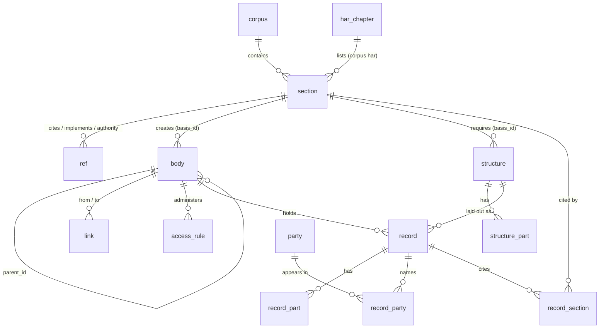

# Schema

One SQLite database, `data/hawaii.db`, defined in [schema.sql](schema.sql). Four layers:

1. **Law**: every section of every statute, constitution, court rule, administrative rule, opinion and code, plus the
   citations between them.
2. **Government**: every body (branch, department, court, county, board, office, fund), what creates it, and how bodies
   connect.
3. **Structures**: document layouts the law requires (for example the 23 items of a Franchise Disclosure Document).
4. **Records**: the public records you add, linked to the body that holds them, the parties as published, the law they
   cite, and the mandated structure they follow.

The same three rules hold everywhere:

- Every row that states something carries `source_url`, the public place the original can be read.
- A value that was not found is `NULL`. Nothing is guessed into a fact column.
- Anything derived by parsing says so (`provenance`, `origin`, `basis`, `verified`) so it can be checked.

## Law

| Table | One row is | Key columns |
|---|---|---|
| `corpus` | a body of law (HRS, HAR, USC …) | `id`, `jurisdiction`, `kind`, `publisher`, `provenance`, `sections` |
| `section` | one section, rule, article or opinion | `id`, `citation` (as published), `cite_key`, `heading`, `chapter`, `ord`, `status`, `text`, `source_url` |
| `section_fts` | full-text index over `section` | `citation`, `heading`, `path`, `text` |
| `ref` | one citation from one section to another | `from_id`, `to_key`, `to_id`, `kind`, `basis` |
| `har_chapter` | one chapter in the LRB HAR directory | `title`, `chapter`, `chapter_name`, `listed_under`, `repealed`, `have_text` |

**Section ids** are `<corpus>:<number>`: `hrs:92F-12`, `har:16-37-3`, `usc:42-1983`, `cfr:16-436.5`. Constitutions and
court rules, which have no single number, use their normalized citation: `hi-const:haw const art vi 1`,
`hi-rules:haw r civ p 23`.

**`cite_key`** is the normalized citation. [cite.py](../cite.py) turns anything a person types (`HRS 712-1200`,
`Haw. Rev. Stat. § 712-1200`, `712-1200`) into the same key, so lookups don't depend on punctuation.

**`ref.kind`**: `cites` (the text names another section), `implements` (a rule names the statute it implements, from
its "Imp:" note or the LRB table), `authority` (a rule's "Auth:" note), `chapter` (the text names a whole chapter).
`ref.basis` says which: `text`, `imp-note`, `auth-note`, `lrb-2025-table`.

**`status`** is the publisher's: `in_force`, `repealed`, `reserved`, `expired`, `omitted`, `transferred`, `renumbered`.
Search leaves out everything but `in_force` unless you ask for all (`--all`, or "including repealed").

## Government

| Table | One row is | Key columns |
|---|---|---|
| `body` | a part of government | `id`, `name`, `level`, `branch`, `kind`, `parent_id`, `basis_cite`, `basis_id`, `basis_quote`, `verified`, `origin` |
| `link` | a legal relationship between two bodies | `from_id`, `to_id`, `relation`, `basis_cite`, `basis_quote`, `verified` |
| `access_rule` | a law that opens a kind of record or meeting to the public | `record_kind`, `body_id`, `basis_cite`, `basis_quote`, `verified` |

**Body ids** read from the top down: `hi`, `hi.exec`, `hi.exec.dept.26-13` (the Department of Health, created by
HRS § 26-13), `hi.exec.dept.26-13.head`, `hi.jud.circuit`, `co.honolulu`, `us.jud.ca9`. Bodies found by pattern are
`hi.mined.<section>.<name>`.

**`link.relation`**: `supervised_by`, `appointed_by`, `nominates_judges_to`, `listed_in`, `appeals_to`,
`certiorari_to`, `transfer_to`, `contested_case_review_in`, `state_of`.

**`verified = 1`** means the quoted words were found in the cited provision's text when the database was built.

## Structures

| Table | One row is | Key columns |
|---|---|---|
| `structure` | a layout the law requires | `id` (`fdd`), `name`, `basis_cite`, `source_url` |
| `structure_part` | one required part | `structure_id`, `ord`, `label` (`Item 19`), `heading`, `text` (what the law says it must contain) |

Parts are parsed from the requiring provision's text, so they change when the law does.

## Records

| Table | One row is | Key columns |
|---|---|---|
| `record` | one public record you added | `id`, `kind`, `jurisdiction`, `body_id`, `number`, `title`, `date`, `status`, `structure_id`, `text`, `meta`, `source_url`, `retrieved` |
| `record_fts` | full-text index over `record` | `number`, `title`, `text` |
| `party` | a name as published | `id`, `name`, `kind` |
| `record_party` | a party's appearance in a record | `record_id`, `party_id`, `role` |
| `record_section` | law a record cites | `record_id`, `section_id`, `relation` |
| `record_part` | one part of a structured document | `record_id`, `ord`, `label`, `text`, `page_from`, `page_to` |

Records come in through `hi.py load <file.jsonl>`; the line format is in the [README](../README.md#add-your-records).
A record whose `structure_id` is `fdd` and whose `parts` are labelled `Item 1` … `Item 23` lines up item by item
with what 16 C.F.R. § 436.5 requires.

## Files and listings

| Table | One row is | Key columns |
|---|---|---|
| `source_file` | one original file as downloaded | `sha256` (fingerprint), `original_filename`, `source_url`, `retrieved`, `size_bytes`, `local_path`, `has_text_layer` |
| `record_file` | which file a record came from | `record_id`, `sha256` |
| `listing_entry` | one entry on a public listing page on a given day | `source_page_url`, `seen_on`, `listing_order`, `listing_title`, `program`, `record_id` |

A record's `files` and `listings` (see the README) fill these tables. If the publisher replaces a file, the new
file has a new fingerprint and gets its own row; the old row stays.

`fdd_items` is a view with one column per FDD item (`item_01_franchisor` … `item_23_receipts`), read from
`record_part` for records whose `structure_id` is `fdd`. The text is stored once, in `record_part`.
